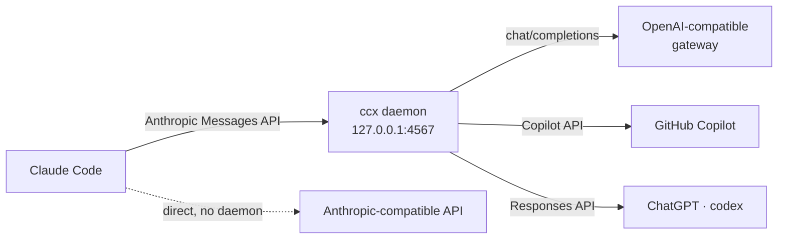

# ccx

**Run Claude Code on any LLM provider — one binary, no proxies.**

[](https://github.com/ivangurin/ccx/releases)
[](LICENSE)
[](https://go.dev)
[](https://github.com/ivangurin/ccx/releases/latest)

Claude Code is a great coding agent — but it speaks exactly one language: the
Anthropic Messages API. ccx lets you point it wherever you want: an
OpenAI-compatible gateway, GitHub Copilot, your ChatGPT subscription, or any
Anthropic-compatible API. A tiny local daemon translates the traffic on the
fly; from Claude Code's point of view, nothing changed.

A Go rewrite of a well-worn bash tool of the same name — same behavior, packed
into a single binary with nothing else to run or babysit.

## Why ccx?

- **One binary, no moving parts.** No Node.js sidecar, no Docker, no external
  router to keep alive. Everything ccx needs — CLI, daemon, translators,
  OAuth flows — lives inside one static binary.
- **Speaks your provider's language.** The daemon translates the Anthropic
  Messages API into OpenAI chat/completions, the GitHub Copilot API or the
  ChatGPT Responses API. Anthropic-compatible providers are passed through
  untouched — no translation needed.
- **Careful with your setup.** A switch edits only the env block and the model
  pin in Claude Code's `settings.json`; key order, indentation and your own
  variables survive byte-for-byte. If anything goes wrong mid-switch, the file
  is left alone and you stay on the previous provider.
- **Credentials stay on your machine.** Nothing is sent anywhere except
  upstream to your provider. For OpenAI-compatible providers the daemon holds
  no secret at all — your token travels from Claude Code straight through.
- **Subscriptions are first-class.** GitHub Copilot (OAuth device flow) and
  ChatGPT/Codex (your existing `~/.codex` login) work out of the box.

## Supported providers

| Protocol | Talks to | Replaces |
|---|---|---|
| `anthropic` | any Anthropic-compatible API (z.ai, …) | — (direct passthrough) |
| `openai` | OpenAI chat/completions — api.openai.com, corporate gateways | claude-code-router |
| `copilot` | GitHub Copilot (OAuth device flow + prefill fix) | copilot-api + copilot-bridge |
| `codex` | ChatGPT Responses API (subscription) | claude-codex |

<details>
<summary>Provider notes</summary>

- **copilot** — authenticate once with `ccx auth <key>` (GitHub OAuth device
  flow); ccx caches and refreshes the token after that.
- **codex** — authenticate once with `ccx auth <key>` (ChatGPT OAuth: the
  browser opens auth.openai.com, ccx catches the callback). Streaming only,
  and it always sends `store: false`.
- Auth is per-provider: credentials live in `~/.ccx/auth/<key>.json`, and
  `ccx auth` with no argument lists every provider's auth state. Two
  accounts of one protocol is just two providers:

  ```json
  "providers": {
    "gh-personal": {"name": "GitHub Copilot (personal)", "protocol": "copilot", "models": [...]},
    "gh-work":     {"name": "GitHub Copilot (work)",     "protocol": "copilot", "models": [...]}
  }
  ```

  `ccx auth gh-personal` and `ccx auth gh-work` each run their own GitHub
  login into their own store.
- **openai** — works with api.openai.com and corporate OpenAI-compatible
  gateways; your token is pass-through (see above). Gateways that block Go's
  default User-Agent are handled — ccx masquerades as a regular client.

</details>

## Install

macOS (Apple Silicon and Intel) via Homebrew:

```bash
brew install ivangurin/tap/ccx
```

The formula tracks the latest release and is updated automatically on every
`v*` tag. Upgrading: `brew upgrade ccx`. Uninstalling: `brew uninstall ccx`.

Or without Homebrew (Apple Silicon and Intel):

```bash
curl -fsSL https://raw.githubusercontent.com/ivangurin/ccx/main/install.sh | sh
```

Fetches the latest release and installs it to `/usr/local/bin/ccx`. Building
from source works too: clone the repo and `make install` (or `PREFIX=…
make install` for another location).

Uninstall:

```bash
curl -fsSL https://raw.githubusercontent.com/ivangurin/ccx/main/uninstall.sh | sh
```

Stops the daemon (best-effort) and removes the binary only — `~/.ccx` with
your providers, state and logs stays untouched, and so does the one-time
settings backup `~/.claude/settings.json.bak`.

## Quick start

```bash
ccx init            # create ~/.ccx/providers.json: import + ready templates
ccx edit            # edit your providers and models in $EDITOR
ccx list            # see your providers and their models
ccx                 # interactive menu: pick a provider, pick a model — done
ccx status          # active provider · model
```

`ccx init` scaffolds three ready-made providers (OpenAI, Copilot, ChatGPT
Codex) and imports what it can find in your current setup — add your keys
with `ccx edit`. To switch without the menu: `ccx use <provider> [model]`
(the daemon starts by itself).

## Configuration

Everything lives in `~/.ccx/providers.json`. Connection fields (`base_url`,
`auth_token`, `api_key`, …) sit directly in the provider entry — no nested
protocol blocks — and `protocol` decides which of them are meaningful:

```jsonc
{
  "providers": {
    "zai": {
      "name": "z.ai",
      "protocol": "anthropic",
      "base_url": "https://api.z.ai/api/anthropic",
      "auth_token": "<token>",
      "models": [
        {
          "id": "glm-5.3", 
          "label": "GLM 5.3",   
          "default": true
        },
        {
          "id": "glm-5.3-flash",   
          "label": "GLM 5.3 Flash"
        }
      ]
    },
    "work": {
      "name": "Work gateway",
      "protocol": "openai",
      "base_url": "https://…/v1",
      "auth_token": "<token>",
      "models": [
        {
          "id": "work model", 
          "label": "Work Model", 
          "default": true
        }
      ]
    }
  }
}
```

### Fields

**`daemon` block** — optional, top-level; read by the switcher, which spawns
the daemon with these parameters:

| Field | Type | Required | Default | Meaning |
|---|---|---|---|---|
| `port` | int | no | `4567` | daemon port; actual precedence: `--port` flag > `CCX_PORT` env > `daemon.port` > 4567 |
| `debug` | bool | no | `false` | spawn the daemon with debug logging (debug-level records and request dumps in the daemon log) |

**Provider** — the map key is what you type in `ccx use <key>`:

| Field | Type | Required | Default | Meaning |
|---|---|---|---|---|
| `protocol` | string | **yes** | — | `anthropic` / `openai` / `copilot` / `codex` |
| `name` | string | no | — | display name (menus, `ccx list`) |
| `base_url` | string | for `anthropic` / `openai` | — | upstream URL; `copilot` / `codex` have fixed endpoints and don't use it |
| `auth_token` | string | one of `auth_token` / `api_key` for `anthropic` / `openai` | — | credential; may be a whole-value env reference `$NAME` / `${NAME}`; for `copilot` / `codex` any placeholder works (they own the real one) |
| `api_key` | string | (alternative to `auth_token`) | — | anthropic: sent as `x-api-key`; openai: `Authorization: Bearer`; `auth_token` wins on anthropic |
| `extra_headers` | map | no | — | extra upstream headers (`anthropic` profiles: become `ANTHROPIC_CUSTOM_HEADERS`) |
| `max_tokens_field` | string | no | `max_tokens` | openai: switch to `max_completion_tokens` for gateways that require it |
| `reasoning_to_thinking` | bool | no | `false` | reserved, no effect yet (reasoning deltas already map to thinking blocks unconditionally) |
| `env` | map | no | — | extra env keys written to settings.json on switch (your variables; `ANTHROPIC_*` stays ccx-managed) |
| `models` | list | **yes** | — | the provider's models (see below) |

**Model** — `label` is what menus and `ccx list` show, `id` is what
`ccx use <provider> <model>` accepts (exact match):

| Field | Type | Required | Default | Meaning |
|---|---|---|---|---|
| `id` | string | **yes** | — | the real model id: written to settings.json, accepted by `ccx use` |
| `label` | string | no | the `id` | display text in the menu and `ccx list` |
| `default` | bool | no | `false` | selected when no model is specified (`ccx use <provider>`, menu Enter) |
| `max_context_tokens` | int | no | — | caps the context window Claude Code believes it has (drives the `CLAUDE_CODE_MAX_CONTEXT_TOKENS` env trio); unset → the trio is wiped |
| `effort` | string | no | — | written to `CLAUDE_CODE_EFFORT_LEVEL` verbatim; unset → the key is wiped |

## What ccx does with your settings.json

Of Claude Code's home (`~/.claude`) only `settings.json` is ever touched —
edited in place, never moved or reformatted (`CCX_SETTINGS` points it
elsewhere). A switch changes exactly two things:

- **The env block.** `ANTHROPIC_BASE_URL` + the credential (or the upstream
  URL for a direct `anthropic` provider), the model pin `ANTHROPIC_MODEL`
  and the ccx-owned context/effort keys. Stale `ANTHROPIC_*` keys are swept;
  your own variables (`API_TIMEOUT_MS`, MCP tokens, …) survive untouched —
  an always-env key you set by hand keeps its value.
- **The model pin.** `model`, `availableModels=[m]` and
  `enforceAvailableModels` at the top level.

Everything else — key order, indentation, your own blocks, the trailing
newline — survives a switch byte-for-byte: a fresh env key is appended at
the end of the block, a replaced one keeps its line.

**The one-time backup.** The first switch freezes the original file to
`~/.claude/settings.json.bak` (0600) and later switches never overwrite it.
`ccx restore` copies the backup back and stops the daemon.

**Failure handling.** The file is edited only after the new daemon has
passed its health check; if anything fails mid-switch, settings.json stays
as it was and you remain on the previous provider.

## How it works

Claude Code always talks the Anthropic Messages API. ccx makes sure those
requests reach your provider in its own language:



Switching providers means `ANTHROPIC_BASE_URL` in `settings.json` changes:
translated protocols (openai/copilot/codex) point at the local daemon, while
an `anthropic` provider goes straight to the upstream URL — no daemon
involved.

<details>
<summary>The fine print: daemon lifecycle, credentials, failure handling</summary>

- **Switching restarts the daemon.** For translated protocols, `ccx use`
  spawns a fresh daemon with the new provider as a launch parameter
  (`ccx serve --daemon --provider <key> --port <port>`) and waits for its
  health check. The daemon builds and verifies the route *before* it starts
  listening — so a healthy `/health` means the provider really works. Only
  then is `settings.json` touched; if the daemon never comes up, the switch
  is cancelled, the file stays as it was, and you remain on the previous
  provider.
- **In-flight requests die on a switch.** A restart drops ongoing SSE
  streams — an accepted trade-off of the restart-based switching semantics.
- **anthropic goes direct.** The upstream `base_url` and credential are
  written straight into `settings.json`, and the unused daemon is stopped
  (best-effort).
- **Who holds which credential:** for `openai` the token is pass-through —
  settings.json gets the provider's own token, Claude Code sends it with
  every request, and the daemon forwards it upstream unchanged, holding no
  secret of its own. `copilot` and `codex` own their credentials
  (`~/.ccx/auth/<key>.json`, written by `ccx auth <key>`), so any placeholder
  bearer works from Claude Code's side. The codex store stays
  `auth.json`-compatible: a hand-made symlink of `auth/<key>.json` onto the
  codex CLI's own `~/.codex/auth.json` keeps both tools reading one login.
- **Model pinning.** A switch pins the chosen model: `model`,
  `availableModels=[m]`, `enforceAvailableModels` and all
  `ANTHROPIC_DEFAULT_*_MODEL` values point at it — background tasks stay on
  the model you picked.

</details>

## Commands

| Command | What it does |
|---|---|
| `ccx` | interactive menu: provider → model |
| `ccx init [--force]` | create providers.json (import from settings/env) |
| `ccx edit` | open providers.json in `$EDITOR` (alias: `ccx -e`) |
| `ccx list` | providers and models — model rows show their labels (alias: `ccx -l`) |
| `ccx status` | active provider/model (alias: `ccx -s`) |
| `ccx use <provider> [model]` | switch (alias: `ccx <provider> [model]`) |
| `ccx serve [--daemon] [--debug] --provider <key> [--port N]` | run the daemon in the foreground (`--debug`: debug-level logging — the format stays env-driven — and request dumps into the unified daemon log as `kind=reqdump` lines) |
| `ccx stop` | stop the daemon |
| `ccx restore` | restore the original settings.json from the one-time backup (`~/.claude/settings.json.bak`, frozen at the first switch); stops the daemon |
| `ccx auth [provider]` | login flow for the provider's protocol (copilot device flow / codex OAuth); no argument — auth state of every provider |
| `ccx version` / `ccx help` | version (alias: `ccx -v`) / help |
| `ccx completion <shell>` | shell completion script (zsh/bash/fish/powershell) |

MIT License — see [LICENSE](LICENSE).
