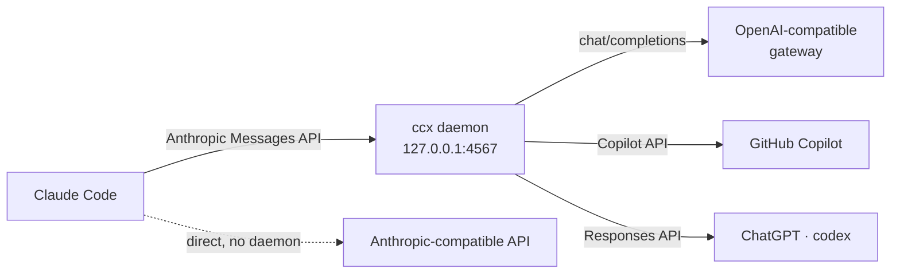

# ccx

**Run Claude Code on any LLM provider — one binary, no proxies.**

[](https://github.com/ivangurin/ccx/releases)
[](LICENSE)
[](https://go.dev)
[](https://github.com/ivangurin/ccx/releases/latest)

Claude Code is a great coding agent — but it speaks exactly one language: the
Anthropic Messages API. ccx lets you point it wherever you want: an
OpenAI-compatible gateway, GitHub Copilot, your ChatGPT subscription, or any
Anthropic-compatible API. A tiny local daemon translates the traffic on the
fly; from Claude Code's point of view, nothing changed.

A Go rewrite of a well-worn bash tool of the same name — same behavior, packed
into a single binary with nothing else to run or babysit.

## Why ccx?

- **One binary, no moving parts.** No Node.js sidecar, no Docker, no external
  router to keep alive. Everything ccx needs — CLI, daemon, translators,
  OAuth flows — lives inside one static binary.
- **Speaks your provider's language.** The daemon translates the Anthropic
  Messages API into OpenAI chat/completions, the GitHub Copilot API or the
  ChatGPT Responses API. Anthropic-compatible providers are passed through
  untouched — no translation needed.
- **Careful with your setup.** A switch edits only the env block and the model
  pin in Claude Code's `settings.json`; key order, indentation and your own
  variables survive byte-for-byte. If anything goes wrong mid-switch, the file
  is left alone and you stay on the previous provider.
- **Credentials stay on your machine.** Nothing is sent anywhere except
  upstream to your provider. For OpenAI-compatible providers the daemon holds
  no secret at all — your token travels from Claude Code straight through.
- **Subscriptions are first-class.** GitHub Copilot (OAuth device flow) and
  ChatGPT/Codex (your existing `~/.codex` login) work out of the box.

## Supported providers

| Protocol | Talks to | Replaces |
|---|---|---|
| `anthropic` | any Anthropic-compatible API (z.ai, …) | — (direct passthrough) |
| `openai` | OpenAI chat/completions — api.openai.com, corporate gateways | claude-code-router |
| `copilot` | GitHub Copilot (OAuth device flow + prefill fix) | copilot-api + copilot-bridge |
| `codex` | ChatGPT Responses API (subscription) | claude-codex |

<details>
<summary>Provider notes</summary>

- **copilot** — authenticate once with `ccx auth copilot` (GitHub OAuth device
  flow); ccx caches and refreshes the token after that.
- **codex** — needs a codex CLI login (`~/.codex/auth.json`; `ccx auth codex`
  checks it). Streaming only, and it always sends `store: false`.
- **openai** — works with api.openai.com and corporate OpenAI-compatible
  gateways; your token is pass-through (see above). Gateways that block Go's
  default User-Agent are handled — ccx masquerades as a regular client.

</details>

## Install

macOS (Apple Silicon):

```bash
curl -fsSL https://raw.githubusercontent.com/ivangurin/ccx/main/install.sh | sh
```

Fetches the latest release and installs it to `/usr/local/bin/ccx`. Building
from source works too: clone the repo and `make install` (or `PREFIX=…
make install` for another location).

Uninstall:

```bash
curl -fsSL https://raw.githubusercontent.com/ivangurin/ccx/main/uninstall.sh | sh
```

Stops the daemon (best-effort) and removes the binary only — `~/.ccx` with
your providers, state, backups and logs stays untouched.

<details>
<summary>Upgrading from the pre-rename release?</summary>

Data from the old release (kept in `~/.claude`) — providers.json, state, the
Copilot token — is copied into `~/.ccx` automatically on the first run; your
new files always win. The old copies can be deleted by hand once you're happy.

</details>

## Quick start

```bash
ccx init            # create ~/.ccx/providers.json: import + ready templates
ccx list            # see your providers and their models
ccx auth copilot    # once — only if you're a Copilot subscriber
ccx use copilot     # switch; the daemon starts by itself
ccx status          # active provider · model
```

Just `ccx` with no arguments opens an interactive menu: pick a provider, pick
a model, done. To pin a specific model, add it: `ccx use work gpt-6-luna`.
`ccx init` scaffolds three ready-made providers (OpenAI, Copilot, ChatGPT
Codex) and imports what it can find in your current setup — edit them with
`ccx edit` and add your keys.

## How it works

Claude Code always talks the Anthropic Messages API. ccx makes sure those
requests reach your provider in its own language:



Switching providers means `ANTHROPIC_BASE_URL` in `settings.json` changes:
translated protocols (openai/copilot/codex) point at the local daemon, while
an `anthropic` provider goes straight to the upstream URL — no daemon
involved.

<details>
<summary>The fine print: daemon lifecycle, credentials, failure handling</summary>

- **Switching restarts the daemon.** For translated protocols, `ccx use`
  spawns a fresh daemon with the new provider as a launch parameter
  (`ccx serve --daemon --provider <key> --port <port>`) and waits for its
  health check. The daemon builds and verifies the route *before* it starts
  listening — so a healthy `/health` means the provider really works. Only
  then is `settings.json` touched; if the daemon never comes up, the switch
  is cancelled, the file stays as it was, and you remain on the previous
  provider.
- **In-flight requests die on a switch.** A restart drops ongoing SSE
  streams — an accepted trade-off of the restart-based switching semantics.
- **anthropic goes direct.** The upstream `base_url` and credential are
  written straight into `settings.json`, and the unused daemon is stopped
  (best-effort).
- **Who holds which credential:** for `openai` the token is pass-through —
  settings.json gets the provider's own token, Claude Code sends it with
  every request, and the daemon forwards it upstream unchanged, holding no
  secret of its own. `copilot` and `codex` own their credentials (the cached
  Copilot token and `~/.codex/auth.json`), so any placeholder bearer works
  from Claude Code's side.
- **Model pinning.** A switch pins the chosen model: `model`,
  `availableModels=[m]`, `enforceAvailableModels` and all
  `ANTHROPIC_DEFAULT_*_MODEL` values point at it — background tasks stay on
  the model you picked.

</details>

## Configuration

Everything lives in `~/.ccx/providers.json`. Connection fields (`base_url`,
`auth_token`, `api_key`, …) sit directly in the provider entry — no nested
protocol blocks — and `protocol` decides which of them are meaningful:

```jsonc
{
  "daemon": {"port": 4567},
  "providers": {
    "zai": {
      "name": "z.ai (GLM)",
      "protocol": "anthropic",
      "base_url": "https://api.z.ai/api/anthropic",
      "auth_token": "<key>",
      "models": [{"id": "glm-5.3[1m]", "label": "GLM 5.3", "default": true}]
    },
    "work": {
      "name": "Work gateway",
      "protocol": "openai",
      "base_url": "https://…/v1",
      "auth_token": "<token>",
      "models": […]
    }
  }
}
```

Of Claude Code's home (`~/.claude`) only `settings.json` is ever touched —
edited in place, never moved or reformatted.

<details>
<summary>Details: ports, legacy files, env overrides</summary>

- **Daemon port precedence:** `--port` flag > `CCX_PORT` > `daemon.port` >
  the default 4567. One daemon per `CCX_HOME` (`daemon.lock`); `ccx stop`
  (or `CCX_PORT=<n> ccx stop` for a non-default port) stops it.
- **Legacy files keep working.** Configs from older releases (a top-level
  `profiles` key, `version`, `daemon.auth_token`) still load and are
  rewritten in the current schema on the next save.
- **The client masquerade is code, not config.** User-Agent, editor versions,
  integration id, originator and the Copilot prefill fix live as constants
  next to the translators — they change with the code, not with your config.
- **Paths can be redirected:** `CCX_HOME` moves the ccx data root, `CCX_SETTINGS`
  points at a different settings.json.

</details>

## Commands

| Command | What it does |
|---|---|
| `ccx` | interactive menu: provider → model |
| `ccx use <provider> [model]` | switch (alias: `ccx <provider> [model]`) |
| `ccx list` | providers and models |
| `ccx status` | active provider/model |
| `ccx init [--force]` | create providers.json (import from settings/env) |
| `ccx edit` | open providers.json in `$EDITOR` |
| `ccx serve [--daemon] --provider <key> [--port N]` | run the daemon in the foreground |
| `ccx stop` | stop the daemon |
| `ccx auth copilot` | GitHub OAuth device flow |
| `ccx auth codex` | check codex CLI login |
| `ccx version` / `ccx help` | version / help |

## Development

```bash
make build       # build ./bin/ccx
make test        # tests with coverage (threshold ≥ 80%)
make lint        # golangci-lint on changed files
make lint-full   # golangci-lint on all files
make generate    # mocks + formatting
```

MIT License — see [LICENSE](LICENSE).
